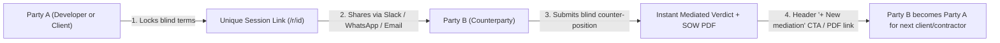

# MidPoint: Double-Blind AI Deal Mediator for Freelance Contracts


**Settle freelance software deals in the middle with zero price anchoring, mathematical fairness, and strict walk-away privacy.**

MidPoint is a zero-signup, double-blind negotiation and Statement of Work (SOW) mediation platform for freelance developers and clients. Both parties independently lock in their project budget, estimated scope hours, upfront deposit, invoice payment cycle (Net days), revision limits, and private walk-away bounds. MidPoint computes a risk-adjusted settlement, evaluates contractual exposure, and generates a ready-to-send SOW agreement and downloadable PDF report in seconds.

---

## Quick Navigation

- [1. Executive Overview](#1-executive-overview)
- [2. Zero-CAC Viral Distribution Loop](#2-zero-cac-viral-distribution-loop)
- [3. Core Mediation Engine and Academic Foundations](#3-core-mediation-engine-and-academic-foundations)
- [4. Multi-Attribute Risk and Cashflow Adjustment](#4-multi-attribute-risk-and-cashflow-adjustment)
- [5. Privacy and Security Architecture](#5-privacy-and-security-architecture)
- [6. Business Model and Monetization Strategy](#6-business-model-and-monetization-strategy)
- [7. System Architecture and Tech Stack](#7-system-architecture-and-tech-stack)
- [8. Getting Started and Local Setup](#8-getting-started-and-local-setup)
- [9. Running Tests and Verification](#9-running-tests-and-verification)
- [10. Project Structure](#10-project-structure)

---

## 1. Executive Overview

### The Problem
Freelance software negotiations suffer from three structural failures:
1. **First-Mover Anchoring Bias:** Whichever party states a number first anchors the negotiation. Developers fear underpricing scope; clients fear overpaying for inflated estimates.
2. **Unpriced Contractual Risk:** A $7,000 project with a 50% upfront deposit and Net 7 payout is economically very different from a $7,000 project with 0% deposit, Net 60 terms, and 5 revision rounds. Standard quotes ignore working-capital exposure and scope-creep risk.
3. **High-Friction Deal Closing:** Even after agreeing on a rough number in chat, turning agreed parameters into a clear Statement of Work (SOW) takes hours of back-and-forth messaging.

### The MidPoint Solution
MidPoint replaces adversarial price haggling with a **three-step double-blind protocol**:
1. **Party A Locks Terms:** Either the Freelance Developer or the Client enters their quote, private walk-away limit, estimated hours, deposit percentage, Net payment days, and revision cap. No account registration or login is required.
2. **Counterparty Responds Blindly:** Party A shares a unique session link (`/r/[id]`) with Party B. Party B sees only the project title and currency, never Party A's numbers or terms, and submits their own position blindly.
3. **Instant Mediated Verdict and SOW:** MidPoint verifies whether the mediated settlement satisfies both parties' private walk-away gates, computes net effective hourly economics, generates a dynamic 4-state action plan, drafts a copy-ready SOW message via DeepSeek Flash (`deepseek-flash`), and exports a branded PDF summary.

[Back to Quick Navigation](#quick-navigation)

---

## 2. Zero-CAC Viral Distribution Loop

MidPoint is engineered from the ground up as a **Zero-CAC (Zero Customer Acquisition Cost)** product where every product usage inherently recruits a new user:



### Why MidPoint Distributes Itself
- **Mandatory Two-Player Loop:** A single user cannot complete a mediation alone. Every session created by a freelancer requires inviting a client (or vice versa), guaranteeing 1 outbound invitation per session.
- **Zero Onboarding Friction:** Judges, clients, and freelancers interact immediately without registration walls, passwords, or paywalls.
- **Rich Social Previews (OpenGraph):** Every `/r/[id]` link dynamically renders context-aware OpenGraph and Twitter metadata displaying the project title, currency, and session status while keeping all financial numbers blind.
- **Embedded Viral Attribution:** Both the session header (`+ New mediation`) and the downloadable PDF report footer (`Settled with MidPoint - Mediate your next deal free` linking back to the app) convert counterparties into initiators for their future projects.

[Back to Quick Navigation](#quick-navigation)

---

## 3. Core Mediation Engine and Academic Foundations

MidPoint's mediation engine (`src/lib/midpoint.ts`) combines classical bilateral mechanism design with practical privacy guarantees tailored for real-world commercial negotiations.

### Academic Foundations
1. **Chatterjee and Samuelson (1983), *"Bargaining Under Incomplete Information"*, Operations Research, 31(5), 835-851:**
   Establishes the symmetric split-the-difference double-auction baseline ($k = 0.5$) for bilateral bargaining under two-sided uncertainty.
2. **Myerson and Satterthwaite (1983), *"Efficient Mechanisms for Bilateral Trading"*, Journal of Economic Theory, 29(2), 265-281:**
   Proves that no bilateral trading mechanism can simultaneously achieve ex-post efficiency, dominant-strategy incentive compatibility, individual rationality, and budget balance. Informed by this impossibility theorem, MidPoint separates **price formation** (anchored on public quotes and contractual risk concessions) from **individual rationality verification** (gated by private walk-away limits).
3. **Keeney and Raiffa (1976), *"Decisions with Multiple Objectives: Preferences and Value Tradeoffs"*, Wiley; and Kalai and Smorodinsky (1975), *"Other Solutions to Nash's Bargaining Problem"*, Econometrica, 43(3), 513-518:**
   Provides the multi-attribute utility framework used to translate non-price contractual concessions (deposit protection, invoice payout latency, revision liability, and scope asymmetry) into a bounded settlement weight adjustment.

### How the Settlement Formula Works (Option B: Gate-and-Clamp Mechanism)

Let:
- $O_{\text{dev}}, O_{\text{client}}$ be the public project quotes submitted by the Developer and Client.
- $R_{\text{dev}}$ be the Developer's private minimum walk-away floor ($R_{\text{dev}} \le O_{\text{dev}}$).
- $R_{\text{client}}$ be the Client's private maximum walk-away ceiling ($R_{\text{client}} \ge O_{\text{client}}$).
- $\Delta_{\text{terms}} \in [-0.20, +0.20]$ be the multi-attribute contractual risk and cashflow adjustment.

**Step 1: Bounded Contractual Weight**

$$w = \text{clamp}(0.50 + \Delta_{\text{terms}}, 0.30, 0.70)$$

**Step 2: Candidate Public-Quote Settlement**

$$O_{\text{low}} = \min(O_{\text{dev}}, O_{\text{client}}), \qquad O_{\text{high}} = \max(O_{\text{dev}}, O_{\text{client}})$$

$$P_{\text{raw}} = \text{round}\big(O_{\text{low}} + w \cdot (O_{\text{high}} - O_{\text{low}})\big)$$

**Step 3: Private Reservation Feasibility Gate and Clamp**

$$\text{hasZopa} = (R_{\text{dev}} \le R_{\text{client}}) \land (\text{lo} \le \text{hi})$$

$$P^* = \text{clamp}(P_{\text{raw}}, \text{lo}, \text{hi}), \qquad \text{where } \text{lo} = \max(R_{\text{dev}}, O_{\text{low}}),\ \text{hi} = \min(R_{\text{client}}, O_{\text{high}})$$

### Key Mechanism Properties
- **Interior Privacy Protection ($\partial P^* / \partial R_{\text{dev}} = 0$ and $\partial P^* / \partial R_{\text{client}} = 0$):** For all interior deals where $P_{\text{raw}} \in [\text{lo}, \text{hi}]$, neither party's private walk-away limit affects $P^*$. As a result, neither party can algebraically invert the settlement price to recover the counterparty's exact private floor or ceiling.
- **No Interior Incentive to Shade Private Walk-Away Limits:** Raising $R_{\text{dev}}$ or lowering $R_{\text{client}}$ inside the feasible range does not move the interior settlement price $P_{\text{raw}}$.
- **Clamp Protection Against Extreme Public Bluffing:** If a party submits an inflated public quote, the reservation clamp $[\text{lo}, \text{hi}]$ prevents $P^*$ from ever crossing the counterparty's private walk-away limit.

[Back to Quick Navigation](#quick-navigation)

---

## 4. Multi-Attribute Risk and Cashflow Adjustment

Freelance contracts are multi-dimensional. MidPoint mediates five core parameters simultaneously (`budget`, `hours`, `depositPct`, `netDays`, `revisions`) and computes an itemized adjustment $\Delta_{\text{terms}} \in [-0.20, +0.20]$ around the $50/50$ baseline:

| Contractual Factor | Mediated Condition | Weight Shift ($\Delta_{\text{terms}}$) | Economic Rationale |
| :--- | :--- | :--- | :--- |
| **Upfront Deposit** | `0%` upfront deposit | `+8.0%` toward Developer | Compensates Developer for 100% working-capital exposure |
| **Upfront Deposit** | `1% - 29%` upfront deposit | `+5.0%` toward Developer | Compensates for low upfront commitment |
| **Upfront Deposit** | `>= 50%` upfront deposit | `-5.0%` (Client discount) | Rewards Client for strong upfront cashflow protection |
| **Invoice Payout Cycle** | `Net 45+` days | `+7.0%` toward Developer | Compensates for extended invoice financing delay |
| **Invoice Payout Cycle** | `Net 30 - 44` days | `+4.0%` toward Developer | Compensates for standard corporate payout lag |
| **Invoice Payout Cycle** | `Net 0 - 7` days | `-4.0%` (Client discount) | Rewards Client for rapid invoice settlement |
| **Revision Cap** | `>= 5` revision rounds | `+5.0%` toward Developer | Prices in high iteration and scope-creep liability |
| **Revision Cap** | `4` revision rounds | `+3.0%` toward Developer | Prices in expanded review cycles |
| **Revision Cap** | `<= 1` revision round | `-3.0%` (Client discount) | Rewards Client for tight specification discipline |
| **Risk Flags** | Explicit risk flags (`Vague specs`, `Strict deadline`, etc.) | Up to `+4.0%` (capped) | Bounded cap prevents unilateral flag-stuffing manipulation |
| **Scope Asymmetry** | Developer hours `> 1.15x` Client hours | `+3.0%` toward Developer | Accounts for technical implementation complexity gap |
| **Scope Asymmetry** | Client hours `> 1.15x` Developer hours | `-2.0%` (Client discount) | Accounts for Client scope buffer headroom |

### Dynamic 4-State Action Plan
Depending on overlap status and the composite Payment Risk Score (`0 - 100`), MidPoint generates a context-specific post-mediation playbook:
1. **`READY FOR KICKOFF` (Low Risk, Aligned Scope):** Direct milestone execution checklist with exact deposit and completion payout figures.
2. **`CONDITIONAL APPROVAL` (Moderate Risk or Scope Gap):** Targeted contractual guardrails (change-order triggers, time-boxed revision windows, and late-fee clauses).
3. **`HIGH EXPOSURE WARNING` (High Payment Risk Score):** Mandatory protective interventions before work begins (milestone escrow locks, staging revocation rights, and deposit restructuring).
4. **`WAYS TO BRIDGE THIS GAP` (No Overlap):** Privacy-safe Pareto bridge paths:
   - **Path 1 (Full Scope Compromise):** Target budget midpoint for the mediated hour scope.
   - **Path 2 (Scope-Capped MVP):** Exact hour cap at the Client's stated budget so the Developer still earns their full effective hourly rate.
   - **Path 3 (Payment Term Trade-Off):** Upfront deposit and Net-day adjustments to unlock budget flexibility.

[Back to Quick Navigation](#quick-navigation)

---

## 5. Privacy and Security Architecture

MidPoint enforces strict server-side data isolation in `src/lib/store.ts`, `src/lib/llm.ts`, and `src/lib/validation.ts`:

- **Pre-Reveal Blind Guarantee:** While a session is in `waiting` status, `GET /api/negotiations/[id]` for Party B strips `positionA` completely. Only `projectTitle`, `currency`, `creatorRole`, and `platformFeeHint` are returned.
- **Post-Reveal Walk-Away Redaction:** Even after both parties submit (`revealed` status), `stripPrivateFields` removes `reservation`, `targetHourlyRate`, and `maxBudgetCeiling` before serializing the response. Furthermore, `sanitizeSummaryForViewer` redacts `targetDeltaPct` for non-developer viewers.
- **LLM Privacy Guardrails:** Prompts sent to DeepSeek (`src/lib/llm.ts`) undergo post-generation validation (`leaksReservationNumber`, `containsForbiddenJargon`, `containsPlaceholderLeak`) to ensure neither private reservation numbers nor raw template placeholders ever appear in generated copy.
- **HMAC Capability Token and Multi-Endpoint Rate Limiting:**
  - AI SOW draft regeneration (`POST /api/negotiations/[id]/draft`) requires a per-session HMAC-SHA256 capability token (`deriveDraftAccessToken` signed with `DRAFT_TOKEN_SECRET`) issued only to verified session participants, backed by per-session sliding-window rate limiting (`6 requests/minute`).
  - Session creation (`POST /api/negotiations`) and counterparty submission (`POST /api/negotiations/[id]/respond`) enforce IP-based sliding-window rate limits (`20 requests/minute/IP` and `15 requests/minute/IP` respectively) to prevent automated abuse and protect LLM quota.

[Back to Quick Navigation](#quick-navigation)

---

## 6. Business Model and Monetization Strategy

MidPoint combines a **Zero-CAC viral acquisition engine** with high-margin B2B/FinTech monetization layers, presented transparently in the live in-app [`/pricing`](src/app/pricing/page.tsx) page and 10-row `OVERVIEW` comparison matrix:

| Tier / Stream | Target User | Offering | Pricing Model |
| :--- | :--- | :--- | :--- |
| **1. Core Blind Mediation (Free Forever)** | Individual Freelancers & Clients | Unlimited double-blind sessions, 5-parameter mediation, dynamic risk scoring, SOW draft, and watermarked PDF export | **$0 / month** (Viral Zero-CAC acquisition funnel) |
| **2. MidPoint Pro Workspace** | Full-Time Freelancers, Studios & Agencies | Up to 3 blind re-mediation rounds on No-Overlap deals, custom branding on PDF SOW exports (no watermark), reusable clause templates, and 10 team seats | **$19 / month** (Early Access, $29 anchor) |
| **3. Unlimited & API (B2B)** | Freelance Marketplaces, Dev Shops & Procurement Teams | Unlimited re-mediation rounds, unlimited seats, embeddable `"Settle with MidPoint"` widget, and REST API | **$99 / month** (B2B Beta, $149 anchor) |
| **4. Embedded Milestone Escrow** | Settled Mediated Deals (`hasZopa = true`) | Optional milestone escrow funding directly from the settled verdict card | **0.5% - 1.5% flat settlement fee** (vs. 10%-20% on traditional marketplaces) |

### Why Investors Back This Model
- **Zero-CAC Acquisition:** Traditional freelance platforms spend heavily on paid ads to acquire both sides of the marketplace. MidPoint acquires counterparties organically at **$0 CAC** whenever one party sends a mediation link.
- **High-Intent FinTech Capture Point:** MidPoint sits at the exact moment two parties agree on a dollar figure, an upfront deposit amount, and a Net invoice schedule, making it the highest-conversion entry point for escrow and invoice financing.

[Back to Quick Navigation](#quick-navigation)

---

## 7. System Architecture and Tech Stack

- **Frontend & Full-Stack Framework:** Next.js 15.5 (App Router, React 19, TypeScript, Server Components + Client Interactive Workbench)
- **Styling & Visual System:** Tailwind CSS + custom glassmorphic dark UI (`src/app/globals.css`) + interactive 60fps HTML5 Canvas particle and 3D globe visualizers (`BackgroundCanvas.tsx`, `HeroGlobe.tsx`) + sticky scroll-driven 3-step showcase with live miniature website skeletons (`HowItWorksSection.tsx`)
- **Database & Persistence:** Neon Serverless PostgreSQL + Drizzle ORM (`src/db/schema.ts`, `src/db/index.ts`) with automatic local JSON fallback (`.tmp/negotiations.json`) for zero-config local evaluation
- **AI Mediation & SOW Engine:** DeepSeek API (`deepseek-flash` with low-latency reasoning configuration in `src/lib/llm.ts`) + deterministic fallback copy generator (`src/lib/mediation-copy.ts`)
- **Client-Side PDF Generation:** Custom vector PDF layout engine built on `jsPDF` (`src/lib/export-pdf.ts`) with embedded Plus Jakarta Sans and Victor Mono typography
- **Multi-Currency Support:** 32 global currencies (`USD`, `EUR`, `GBP`, `IDR`, `SGD`, `JPY`, `AUD`, `CAD`, etc.) with locale-aware formatting and step rounding (`src/lib/currency.ts`)
- **Continuous Integration:** Automated GitHub Actions workflow (`.github/workflows/test.yml`) running strict TypeScript checks (`npx tsc --noEmit`) and unit/privacy smoke suites (`npm test`) on every push and pull request

[Back to Quick Navigation](#quick-navigation)

---

## 8. Getting Started and Local Setup

### Prerequisites
- Node.js `v20+` (with `--experimental-strip-types` support for native TypeScript test execution)
- npm `v10+`

### 1. Clone and Install Dependencies
```bash
git clone https://github.com/HackOnVibeCom/ga3gsfvx0bg7cx56vj3y4h9k37guoe15u293fhtk.git
cd MidPoint
npm install
```

### 2. Configure Environment Variables (Optional for Local Testing)
Copy `.env.example` to `.env.local`:
```bash
cp .env.example .env.local
```
- `DATABASE_URL` / `DATABASE_URL_POOLED`: Neon PostgreSQL connection string. If omitted locally, MidPoint automatically persists sessions to `.tmp/negotiations.json`.
- `DEEPSEEK_API_KEY`: Server-side API key for `deepseek-flash` AI rationale and SOW drafting. If omitted, MidPoint gracefully falls back to its deterministic mediation copy engine (`src/lib/mediation-copy.ts`) with zero runtime errors.
- `DRAFT_TOKEN_SECRET`: Dedicated HMAC-SHA256 secret used to sign per-session draft regeneration tokens.

### 3. Run the Development Server
```bash
npm run dev
```
Open `http://localhost:3000` (Landing & Workbench) or `http://localhost:3000/pricing` (Pricing & Overview Matrix) in your browser.

### 4. Production Deployment on Vercel
1. Import the repository into **Vercel** (Framework Preset: **Next.js**).
2. Add the environment variables in Vercel Project Settings:
   - `DATABASE_URL` and `DATABASE_URL_POOLED` (Neon PostgreSQL)
   - `DEEPSEEK_API_KEY` (DeepSeek API)
   - `DRAFT_TOKEN_SECRET` (random 32+ character secret string)
3. Push the Drizzle PostgreSQL schema to Neon:
   ```bash
   npm run db:push
   ```
4. Deploy. All SSR routes (`/`, `/pricing`, `/r/[id]`) and API endpoints (`/api/negotiations/...`) are ready immediately.

### 5. How Judges Can Test the Full Flow in 60 Seconds
1. Open the live URL (or `http://localhost:3000`) and scroll through the **How it works** 3-step showcase or click **Start blind mediation**.
2. Click one of the quick-load scenario pills (for example, **SaaS MVP Build** or **Landing Page Redesign**) or enter custom values, then click **Lock Developer Terms & Get Share Link**.
3. Copy the generated counterparty share link (`/r/[id]`) and open it in a new browser tab.
4. Select a counterparty preset or enter Client values and click **Submit Client Terms & Reveal MidPoint**.
5. Inspect the mediated settlement, risk breakdown, 4-state action plan, click **Accept Mediated Deal & Copy SOW**, test **Download PDF**, and visit `/pricing` to review the 3-tier business model.

[Back to Quick Navigation](#quick-navigation)

---

## 9. Running Tests and Verification

MidPoint includes automated unit, mechanism verification, and E2E store privacy tests covering ZOPA computation, zero-leakage privacy proofs, multi-attribute contractual adjustments, 4-state action plans, IDR/multi-currency formatting, pre/post-reveal walk-away redaction, HMAC capability tokens, sliding-window rate limiting, and payload validation.

```bash
# Run the test suite (23 unit, privacy, and E2E store tests across 8 suites)
npm test

# Run strict TypeScript type-checking
npx tsc --noEmit

# Build for production
npm run build
```

[Back to Quick Navigation](#quick-navigation)

---

## 10. Project Structure

```text
.
|-- .env.example                 # Environment variable template (Neon DB, DeepSeek, HMAC secret)
|-- .github/workflows/test.yml   # GitHub Actions CI pipeline (tsc + node test runner)
|-- drizzle.config.ts            # Drizzle Kit configuration for PostgreSQL migrations
|-- package.json                 # Scripts and dependencies
|-- public/
|   |-- fonts/                   # Embedded TTF fonts for vector PDF export
|   `-- images/how-it-works/     # Studio portrait assets (tahap-1.png - tahap-3.png)
|-- src/
|   |-- app/
|   |   |-- api/negotiations/    # REST endpoints: create, fetch, respond, and AI draft
|   |   |-- pricing/page.tsx     # Dedicated 3-tier SaaS pricing & overview comparison page
|   |   |-- r/[id]/page.tsx      # Dynamic session page + OpenGraph metadata generator
|   |   |-- globals.css          # Design system tokens and utility classes
|   |   |-- layout.tsx           # Root layout, fonts, and background canvas
|   |   `-- page.tsx             # Landing hero, How it works showcase, and DealWorkbench entry
|   |-- components/
|   |   |-- Header.tsx           # Global navigation header (How it works, Workbench, Pricing)
|   |   |-- Footer.tsx           # Global footer with quick navigation links
|   |   |-- HowItWorksSection.tsx# Sticky 3-step showcase with live website skeleton cards
|   |   |-- PricingView.tsx      # 3-tier pricing cards, 10-row OVERVIEW matrix & Coming Soon modal
|   |   |-- DealWorkbench.tsx    # Interactive 5-term negotiation workbench with progressive disclosure
|   |   |-- LiveDealAside.tsx    # Real-time effective hourly rate & risk meter
|   |   |-- WaitingPanel.tsx     # Party A waiting room with live polling & share link
|   |   |-- PositionForm.tsx     # Party B blind response wrapper
|   |   `-- ResultPanel.tsx      # Mediated verdict, 2-layer No-Overlap card, SOW draft & PDF export
|   |-- db/
|   |   |-- index.ts             # Neon serverless database client
|   |   `-- schema.ts            # Drizzle ORM negotiations table schema
|   `-- lib/
|       |-- midpoint.ts          # Core mediation engine, ZOPA gate, risk & action plan
|       |-- midpoint.test.ts     # 23 automated unit, privacy & E2E store verification tests
|       |-- llm.ts               # DeepSeek Flash integration + privacy/jargon guards
|       |-- mediation-copy.ts    # Deterministic fallback rationale & SOW generator
|       |-- export-pdf.ts        # Client-side vector PDF generator (jsPDF)
|       |-- store.ts             # Dual-mode persistence, HMAC capability tokens & rate limiters
|       |-- currency.ts          # 32-currency configuration and money formatters
|       |-- presets.ts           # Role-aware realistic freelance scenario presets
|       `-- validation.ts        # Strict server-side payload validation
`-- tsconfig.json                # TypeScript compiler configuration
```

[Back to Quick Navigation](#quick-navigation)
